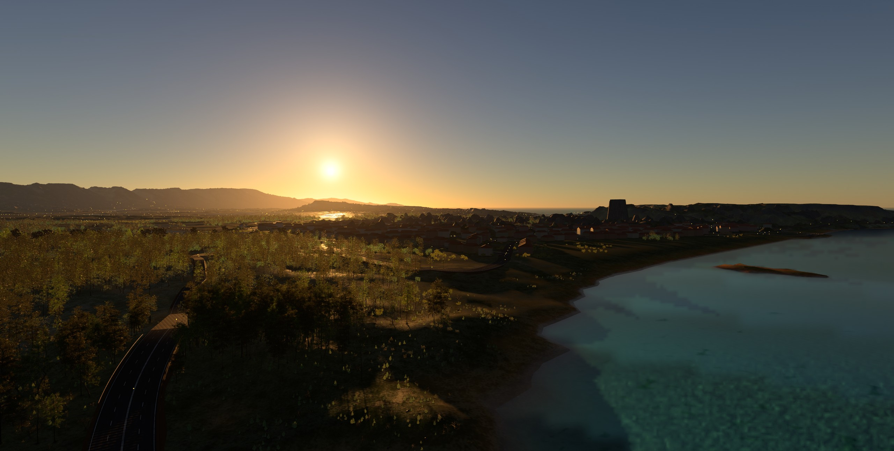

  

<h1 align="center">The Plan</h1>

<h3 align="center">An open-world racing game. Built on Spartan. Shipping on Steam.</h3>

<i>Open roads &nbsp;·&nbsp; open water &nbsp;·&nbsp; your island</i>

  
  
  

 

## The game

**Zakynthos** is a racing game set on a real Greek island, some 30 km across. Towns, an airport and more than 200 roads, all connected and all drivable. You start at your front door, in your own garage, with a car and a budget. Everything after that is the island.

It is not a tech demo and it is not a trailer. It is a game you buy on Steam, launch, and play for hours: drive, race, earn, tune, and come back tomorrow.

<table>
  <tr>
    <td width="33%" valign="top" align="center"><h3>Drive</h3>Racing-sim physics at 200 Hz. Pacejka tires, thermal brakes, real weight transfer. Every road on the island is yours.</td>
    <td width="33%" valign="top" align="center"><h3>Tune</h3>A tune shop in the tradition of the old garage racers: engine, induction, exhaust, drivetrain, suspension, brakes, tires, body and service.</td>
    <td width="33%" valign="top" align="center"><h3>Belong</h3>A home with a garage, a lounge and a bar. A living island with traffic, people, wildlife, weather and a full day and night.</td>
  </tr>
</table>

## Why Spartan builds a game

**A game is the only honest benchmark.** A shipped game on Steam answers *"what can Spartan do?"* better than any screenshot. People can play it, judge it and buy it.

**It forces the engine to grow up.** Every gap between "impressive renderer" and "engine you can ship with" shows up the moment real players touch it: loading, saving, menus, input, performance on ordinary hardware, crashes. The game finds the gaps and the engine closes them.

**It is the real deal.** Not a vision board and not a someday. The island already exists in `worlds/game.world`, it already boots into a main menu, and you can already drive it.

## Already on the island

<table>
  <tr>
    <td width="50%" valign="top">
      <b>The world</b> 
      
      Zakynthos at real scale: towns, an airport, 200+ spline roads with layered asphalt, paint and gravel shoulders, roadside posts and guardrails, instanced forests and an FFT ocean.
        
      Dynamic time of day, atmospheric scattering, volumetric clouds and fog, and rain that soaks the roads and changes tire grip.
        
      Birds and insects, wind-blown leaves and shore haze, traffic and pedestrians.
      
    </td>
    <td width="50%" valign="top">
      <b>The game loop</b> 
      
      A cinematic title screen that drifts through your garage, lounge, workshop and bar to its own soundtrack, then hands you the car at your front door for <b>free roam</b>.
        
      A <b>tune shop</b> with staged parts, live before-and-after stats, adjustable settings (final drive, brake balance, torque split, alignment) and a <b>credit wallet</b>. Parts stay owned once bought.
        
      <b>Service and wear</b>: oil ages, chassis fatigue builds up, nitrous bottles empty and get refilled. Garage and wallet save automatically.
      
    </td>
  </tr>
  <tr>
    <td valign="top">
      <b>The driving</b> 
      
      Pacejka MF 5.2 tires with heat, pressure and wear. Thermal brakes with fade. Turbos, superchargers, nitrous and limited-slip differentials. Aero with downforce and DRS. Steering wheels with force feedback.
      
    </td>
    <td valign="top">
      <b>The engine underneath</b> 
      
      Path-traced global illumination, DLSS, FSR and XeSS, AI race and route drivers, car resets, skid marks, Lua gameplay scripting, a standalone runtime, a game builder that packages the world, and Steam integration with achievements, stats and rich presence.
      
    </td>
  </tr>
</table>

## The road to Steam

The milestones between today's island and a store page. Each one is a slice of the game a player would notice.

#### 1 &nbsp;·&nbsp; Racing

- [ ] Race events placed on the island: sprints, circuits, hill climbs and point-to-points on the existing roads
- [ ] AI opponents built on the race drivers, with difficulty that respects the player's tune
- [ ] Start lines, checkpoints, timing, results screen and rewards

#### 2 &nbsp;·&nbsp; Career

- [ ] Credits earned from races, so the economy has a source as well as a sink
- [ ] A car dealer and a roster to grow into, with each car's owned parts kept per car
- [ ] Progression that pulls the player around the island, town by town

#### 3 &nbsp;·&nbsp; The island as a game

- [ ] The tune shop as a building you drive to, instead of the main menu's developer quick jump
- [ ] A map, a GPS route to the next event and points of interest
- [ ] Ambient life everywhere the player goes: traffic density, people in towns, sounds of the coast

#### 4 &nbsp;·&nbsp; Ship quality

- [ ] Settings menu: graphics presets, resolution, upscalers, audio, controls and wheel setup
- [ ] Performance targets on mainstream GPUs, not just high-end ones
- [ ] Robust saves, fast loading, no crashes in a full session
- [ ] Photo mode

#### 5 &nbsp;·&nbsp; Launch

- [ ] Achievements and stats wired to real moments in the game
- [ ] Store page, capsule art, screenshots and a trailer captured in-engine
- [ ] Playtesting with the community, then Early Access or full release

## The vision is the task list

Once the game is in your head, you know what needs doing. Boot `game.world`, drive for ten minutes and compare it with the game you would buy.

> The race feels empty? *Now you know.*
>
> The town at night doesn't look like a town at night? *Now you know.*
>
> The engine note doesn't match the car? *Now you know.*
>
> The garage doesn't feel like home? *Now you know.*

Nobody needs to assign you a task. The game tells you what's missing, your taste tells you what isn't good enough, and your skills tell you what you can fix.

## Get involved

> [!TIP]
> Open `worlds/game.world` in the editor and press play. The island's Lua lives next to it: `game.lua` sets up the world, `plan_main_menu.lua` is the title screen and `plan_tune_shop.lua` is the tune shop.

  &nbsp;
  &nbsp;
  

 

  <b>First, we finish the island.</b>
   
  <b>Then, we put it on Steam.</b>

